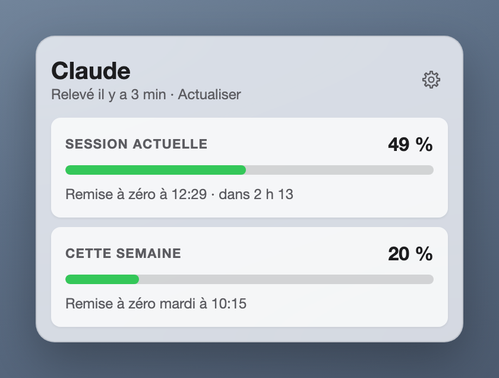

# Claude Usage

La consommation de l'abonnement Claude dans la barre de menus du Mac.



Une icône et un pourcentage à côté de l'horloge : où en est la session en cours. Un clic ouvre un panneau avec les deux limites de l'abonnement, comme sur la page d'usage de Claude :

- **Session actuelle** : le pourcentage utilisé, et l'heure de la remise à zéro ;
- **Cette semaine** : le pourcentage utilisé, et le jour de la remise à zéro.

La barre passe à l'orange à 75 %, au rouge à 90 %.

Application créée par [Anthony Hamo](https://github.com/anthamo). Projet personnel, non affilié à Anthropic.

## Comment elle connaît la consommation

Elle ne se connecte pas à Claude et ne lit aucun mot de passe. Elle passe par **Claude Code**, déjà installé et connecté sur le Mac :

1. **En continu, sans rien coûter.** Quand Claude Code tourne dans un terminal, il donne les deux pourcentages à sa ligne d'état. L'installation ajoute une ligne d'état qui les note au passage (et affiche « Session 49 % · Semaine 20 % » en bas de Claude Code).
2. **À la demande.** « Actualiser », dans le panneau, pose une question d'un mot à Claude et lit les pourcentages dans la réponse. Chaque actualisation consomme une toute petite part de l'abonnement : elle n'est faite que si on la demande, ou si on coche « Actualiser toutes les 15 minutes » dans les réglages.

Pour quelqu'un qui n'utilise que l'app Claude, sans jamais ouvrir Claude Code : il suffit que Claude Code soit installé et connecté à son compte, et de cocher cette case. La première actualisation part alors dès le lancement de l'app. Toutes les 15 minutes, cela pèse de l'ordre de 0,4 % de la limite hebdomadaire (estimation détaillée dans `essais/sonde.md`).

Entre deux relevés, l'app sait quand une limite se remet à zéro : elle l'affiche à 0 % sans attendre.

## Ce qu'il faut

- Un Mac sous macOS 26.
- Un abonnement Claude (Pro, Max ou Ultra) et [Claude Code](https://claude.com/claude-code) installé et connecté.
- [uv](https://docs.astral.sh/uv/), l'outil qui installe Python et ses bibliothèques. S'il manque, l'installation ci-dessous commence par lui.

## Installer

D'abord uv, s'il n'est pas déjà là (`uv --version` répond par un numéro de version quand il l'est) :

```sh
curl -LsSf https://astral.sh/uv/install.sh | sh
```

C'est la commande officielle : elle télécharge uv depuis le site de son éditeur, Astral, et le range dans `~/.local/bin`, sans mot de passe. Avec Homebrew, `brew install uv` fait la même chose. Ouvrir ensuite une nouvelle fenêtre de terminal pour que la commande `uv` soit reconnue.

Puis l'app :

```sh
git clone https://github.com/anthamo/claude-usage.git
cd claude-usage
./installer.sh
```

Le script prépare l'environnement, branche la ligne d'état de Claude Code, crée « Claude Usage » dans le dossier Applications, active le lancement à l'ouverture de session et ouvre l'app.

**Installer avec Claude.** [INSTALLER_AVEC_CLAUDE.md](INSTALLER_AVEC_CLAUDE.md) contient une consigne à coller dans Claude Code : il fait l'installation pas à pas et vérifie que tout marche.

## Ce que l'installation change sur le Mac

| Quoi | Où |
| --- | --- |
| La ligne d'état de Claude Code | la clé `statusLine` de `~/.claude/settings.json` ; le fichier d'avant est gardé à côté, en `.avant-claude-usage`. Une ligne d'état déjà en place est conservée : elle continue de s'afficher |
| Le dernier relevé et les préférences | `~/Library/Application Support/claude-usage/` |
| Le lancement à l'ouverture de session | `~/Library/LaunchAgents/fr.claude-usage.plist` |
| L'application | « Claude Usage » dans le dossier Applications |

`./desinstaller.sh` défait tout cela.

## En cas de souci

| Symptôme | Quoi faire |
| --- | --- |
| La jauge n'affiche pas de pourcentage | Ouvrir le panneau et cliquer « Actualiser », ou envoyer un message dans Claude Code : le pourcentage arrive avec sa première réponse |
| « Claude Code n'est pas installé sur ce Mac. » | Installer Claude Code, s'y connecter, puis relancer `./installer.sh` |
| « Claude Code ne répond pas comme prévu. » | Claude Code a changé la forme de sa réponse : la ligne d'état continue de fonctionner, seul « Actualiser » est touché |
| Le pourcentage diffère un peu de la page d'usage | Il date du dernier relevé (son âge est écrit sous le titre) : « Actualiser » |
| L'app ne s'ouvre plus après avoir déplacé son dossier | Relancer `./installer.sh` depuis le nouvel emplacement |

## Pour qui veut lire ou modifier le code

Python : PyObjC pour la barre de menus et la fenêtre, une page HTML pour l'intérieur du panneau. Le socle vient de [Hue Controller](https://github.com/anthamo/hue-controller).

```sh
uv run python -m claude_usage            # lancer depuis le dossier du projet ; Ctrl-C pour arrêter
uv run python -m claude_usage --essai    # ouvre le panneau, dit ce qu'il voit, s'arrête
uv run python -m unittest                # les tests : sans réseau, sans lancer Claude
open claude_usage/panneau/index.html     # la page seule, sur de fausses données
```

Les documents de travail : [PRD.md](PRD.md) (le problème, la solution), [DESIGN.md](DESIGN.md) (la direction visuelle), [ARCHITECTURE.md](ARCHITECTURE.md) (les fichiers, les formes, les décisions), [PLAN.md](PLAN.md) (les tâches), [essais/sonde.md](essais/sonde.md) (d'où viennent les chiffres).

Limites connues : pas d'historique ni de détail par modèle ; pas de notification à l'approche de la limite ; « Actualiser » repose sur une réponse de Claude Code qui n'est pas documentée ; installation jamais essayée sur un second Mac.

## Licence

[MIT](LICENSE) : libre de l'utiliser, de le modifier et de le redistribuer, sans garantie.
